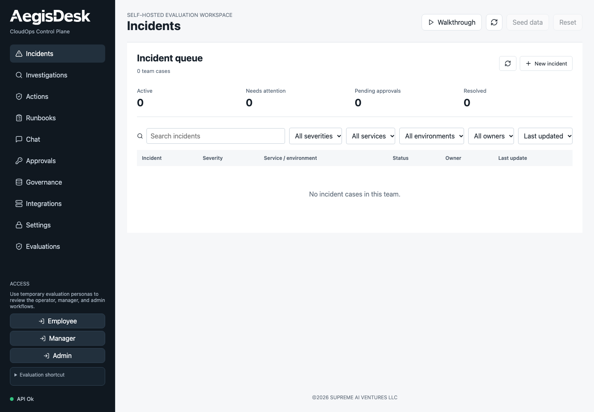
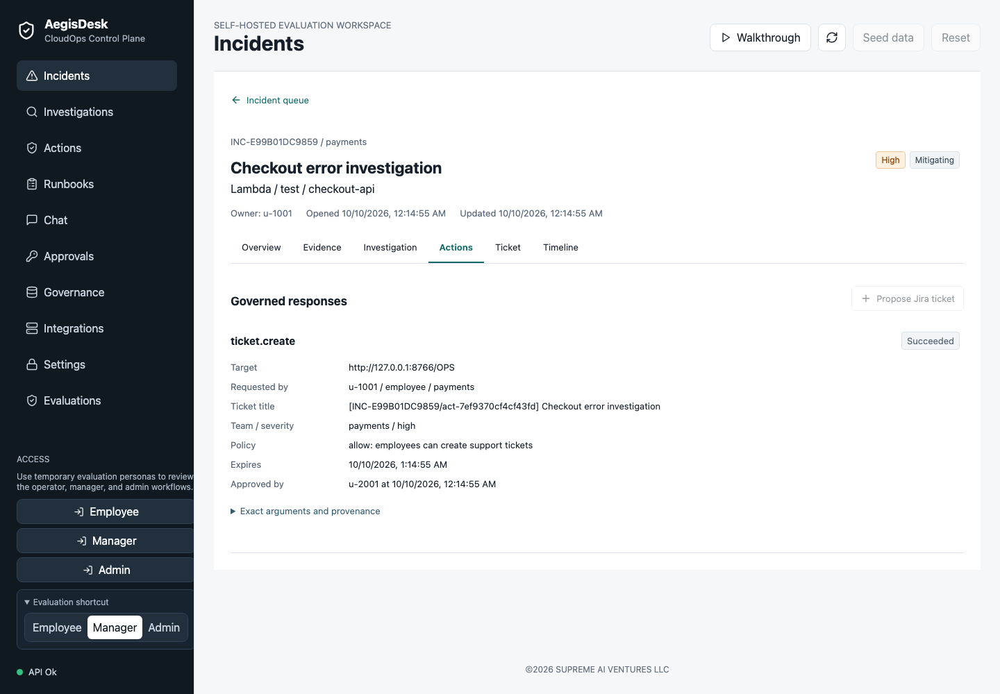

# AegisDesk CloudOps Control Plane

[](https://github.com/manynames3/aegisdesk-cloudops-control-plane/actions/workflows/ci.yml)

AegisDesk is a self-hosted AWS CloudOps control plane for incident investigation and governed response. It preserves team-scoped cases, retrieves read-only evidence and runbooks, requires independent approval of an exact Jira action, and records confirmed or uncertain outcomes. Cognito/JWKS authentication, OPA/Rego policy, redaction, Bedrock routing, DynamoDB audit records, Cost Explorer, and request replay support the workflow.

> Operational AI with identity, policy, approval, and evidence enforced by the backend.

[Live evaluation](https://d27myiy7bbj1rz.cloudfront.net) | [Reviewer guide](docs/reviewer-guide.md) | [C4 architecture](docs/architecture.md) | [ADRs](docs/adrs/README.md) | [Documentation map](docs/README.md)

**Status:** deployed AWS evaluation, not a customer production service. On October 10, 2026, API readiness, authenticated DynamoDB-backed case listing, and desktop/mobile rendering were verified. Hosted case writes and live Jira/CloudWatch workflows remain unverified; those integrations are unconfigured. [Passing CI](https://github.com/manynames3/aegisdesk-cloudops-control-plane/actions/runs/38027806592), [successful deployment](https://github.com/manynames3/aegisdesk-cloudops-control-plane/actions/runs/38027407776), and [verification scope](docs/evidence/live-operations.md).

## Problem, Solution, And Value

- **Problem:** incident context, approvals, and AI answers can become disconnected, leaving operators without a reviewable account of what was requested or executed.
- **Solution:** a case workspace and policy-enforced API keep identity, evidence, exact action arguments, approval, dispatch, and reconciliation together.
- **Operational value:** reviewers can inspect decisions and unresolved outcomes. Operators avoid blind retries after ambiguous ticket responses. No response-time savings or customer usage metrics are claimed.

## Engineering Highlights

- **Policy outside the model:** OPA/Rego evaluates routing and tool permissions; incident actions additionally require an independent, same-team approver and a fingerprint of the exact action.
- **Failure-aware dispatch:** conditional version writes claim execution before external I/O. Timeouts stay unresolved until a matching Jira issue is read and verified; this is not exactly-once delivery.
- **Trustworthy grounding:** packaged runbooks carry source metadata. Case evidence distinguishes empty, unavailable, and stale results; cases never substitute fixture logs.
- **Reviewable governance:** sanitized replay packets, JSON/CSV audit export, correlation IDs, bounded log queries, quotas, and a model kill switch make decisions inspectable.

## Tech Stack

| Area | Implementation |
| --- | --- |
| Frontend | Next.js, TypeScript, Playwright; static AWS export |
| API | Python, FastAPI, Pydantic, Mangum on Lambda |
| Identity and policy | Cognito Hosted UI, PKCE, JWKS; OPA/Rego |
| State | DynamoDB hosted; SQLite local; versioned incident snapshots |
| AI and cost | Bedrock Nova Lite, deterministic fallback, AWS Cost Explorer cache |
| Integrations | In-process CloudWatch/Jira/ServiceNow adapters; separate local-fixture MCP server |
| Infrastructure and delivery | Terraform, S3/CloudFront, API Gateway, GitHub Actions/OIDC, Docker Compose |
| Observability | Structured CloudWatch logs, OpenTelemetry instrumentation, local Jaeger |

## Evidence Matrix

| Area | Evidence |
| --- | --- |
| IaC | [Terraform](infra/terraform/main.tf), fmt/validate in CI, [verified plan/apply](docs/evidence/live-operations.md) |
| CI/CD | [Nine-job CI](.github/workflows/ci.yml), [manual-gated AWS deployment](.github/workflows/deploy-aws.yml) |
| Security | [Runtime IAM](infra/terraform/main.tf), [Cognito/JWKS](services/api/app/auth.py), [Rego policies](policies), [data boundary](docs/security/customer-data-boundary.md), secret scan |
| Reliability | [Versioned dispatch and reconciliation](services/api/app/incidents.py), [failure/recovery procedures](docs/operations/incident-workflow.md) |
| Observability | [Instrumentation](services/api/app/observability.py), [real historical Lambda logs](docs/evidence/live-operations.md); hosted trace export/alerts remain gaps |
| Cost | Serverless idle profile, quotas/cache/kill switch, [cost drivers](docs/deployment/self-hosted.md#expected-cost); Budget is not a spending cap |
| Operations | [Runbooks](docs/operations/README.md), [troubleshooting](docs/support/troubleshooting.md), [cleanup](docs/deployment/self-hosted.md#teardown) |
| Testing | [API tests](services/api/tests), [browser tests](apps/web/tests), [policy tests](policies), [controlled load smoke](docs/evidence/load-smoke.md), MCP/container/infra checks |
| Documentation | [C4](docs/architecture.md), [ADRs](docs/adrs/README.md), [tradeoffs](docs/architecture/tradeoffs.md), [technical evidence](docs/evidence/technical-review.md) |

The October 10 release passed 61 API tests, 13 browser tests, six control evaluations, nine OPA tests, and three container builds. These are dated verification results, not a hosted load benchmark or proof of customer integration readiness.

## Architecture

The browser loads a static Next.js export from CloudFront/private S3 and calls FastAPI through API Gateway/Lambda. The API verifies identity, evaluates packaged OPA policy, redacts data, and uses in-process adapters and DynamoDB state. Bedrock and Cost Explorer are optional routes; CloudWatch/Jira require operator configuration. The standalone MCP server is local fixture tooling, not a production approval boundary.

See the [C4 context/container diagrams, runtime and auth flows, AWS boundaries, and CI/CD shape](docs/architecture.md). [ADR-012](docs/adrs/012-persistent-incident-actions.md) explains the action gate; [tradeoffs](docs/architecture/tradeoffs.md) explain Lambda, DynamoDB, Cognito, and OPA.

## Screenshots

**Hosted AWS evaluation, October 10, 2026:** a real empty team queue, not customer usage or a connected operational integration.



**Controlled local action workflow:** the actual application below used a loopback Jira HTTP fixture and a controlled case, with earlier branding. The action records its target, requester, policy, approver, and outcome. This verifies the local workflow, not live Jira success.



See the [case queue and timeline captures](docs/operations/incident-workflow.md#verification-and-remaining-scope) and [supporting chat/governance gallery](docs/evidence/README.md).

## Try It

Open the [live evaluation](https://d27myiy7bbj1rz.cloudfront.net). Use the sidebar's evaluation access to inspect employee, manager, and admin views. **Walkthrough** exercises redaction, scoped access approval, and governance replay. In **Governance**, select an event to inspect its decision packet or export JSON/CSV. Access approval records do not provision AWS access.

The [product page](https://d27myiy7bbj1rz.cloudfront.net/marketing) and [self-hosted pilot package](docs/product/pilot-package.md) explain the intended deployment audience.

## Local Run

From the repository root, with Docker Compose installed:

```bash
cp .env.example .env
docker compose up --build
```

Open `http://localhost:3000`; API docs are at `http://localhost:8000/docs` and Jaeger at `http://localhost:16686`. Compose explicitly supplies evaluation defaults; changing `.env` alone does not override its service environment.

Direct process alternative, in separate terminals:

```bash
cd services/api
python3 -m venv .venv
.venv/bin/pip install -r requirements.txt
.venv/bin/uvicorn app.main:app --reload --port 8000
```

```bash
npm --prefix apps/web ci
npm run dev:web
```

The direct API's default `auto` policy mode selects OPA when available/configured, otherwise Python policy fallback; Compose uses HTTP OPA. See [self-hosted setup](docs/deployment/self-hosted.md) for identity, policy, model, integration, and persistence settings.

## Validation

From the repository root after installing local dependencies; OPA and Terraform must be available for their checks:

```bash
npm run test:api
npm run build:web
npm run test:e2e
npm run evals
npm run smoke:load
npm run smoke:mcp
npm run security:scan
opa test policies
terraform -chdir=infra/terraform init -backend=false
npm run validate:infra
git diff --check
```

CI also builds the API, web, and MCP images. Browser tests use an isolated local Jira fixture; adapter/DynamoDB contract tests do not replace live provider validation. [Test evidence and boundaries](docs/evidence/technical-review.md).

## Deployment And Identity

[Terraform](infra/terraform) provisions the AWS path. [GitHub Actions](.github/workflows/deploy-aws.yml) uses OIDC rather than stored AWS keys: build Lambda package, validate/plan, then apply/publish/invalidate/smoke only with `confirm=deploy` and the configured GitHub environment. Review the plan and cost impact before apply. [Deployment and recovery instructions](docs/deployment/self-hosted.md).

Evaluation supports Cognito Hosted UI sign-in and a labeled shortcut. Temporary persona credentials are generated for reviewers, not personal accounts. A customer deployment must configure its own identity and integrations and disable evaluation access:

```text
NEXT_PUBLIC_AEGISDESK_MODE=production
NEXT_PUBLIC_SHOW_EVALUATION_TOOLS=false
AEGISDESK_PERSONA_ISSUER_ENABLED=false
AEGISDESK_AUTH_MODE=cognito
AEGISDESK_DATA_BOUNDARY_MODE=customer_strict
```

Apply these settings to the actual frontend build and API deployment: current Terraform/Compose evaluation defaults are not a turnkey production configuration. Integration secrets stay server-side; automated Secrets Manager delivery is not implemented.

## Security, Privacy, And Boundaries

The API derives role/team from verified claims, not browser fields. S3 blocks public access and serves through CloudFront origin access control. API ingress is public HTTPS with backend authentication, not a private VPC boundary. Runtime IAM scopes state, logs, and identity resources; Cost Explorer and configurable log-query permissions need explicit review.

Redaction runs before external model routing. `customer_strict` blocks external model calls and fixture workflows, but is not physical network isolation. Replay/storage can contain sensitive operational input; pattern-based redaction is not complete DLP. Incident timelines are mutable, not immutable compliance archives. [Security model](docs/security/security-overview.md), [data handling](docs/security/data-handling.md), and [threat model](docs/security/threat-model.md).

## Observability And Cost

Structured logs capture route, status, duration, trace ID when available, and a separate request correlation ID. Readiness checks cover store and policy. OpenTelemetry can export to local Jaeger; no hosted trace export, managed dashboard, alarm response drill, or SLO attainment is claimed. [Observability evidence](docs/evidence/live-operations.md) and [trace/export limitations](docs/evidence/trace-sample.md).

No always-on AWS compute is required. Prompt limits, role quotas, Bedrock token limits/kill switch, Cost Explorer caching, bounded log queries, API throttling, and short log retention limit exposure. The AWS Budget records a threshold; it does not stop spend. Costs depend on traffic, tokens, storage, and queries, not a guaranteed monthly price. [Cost model](docs/deployment/self-hosted.md#expected-cost).

## Cleanup And Recovery

`docker compose down` stops local services while preserving the data volume. Export required audit/case evidence and review backups before deleting data. For AWS, review the [teardown procedure](docs/deployment/self-hosted.md#teardown), retained state/bucket versions, and external Jira records before an intentional destroy.

Policy failures block mutations. Ambiguous ticket outcomes require reconciliation rather than blind redispatch. Rollback/recovery instructions are documented, but no hosted recovery drill is claimed. [Operational runbooks](docs/operations/README.md) and [incident recovery](docs/operations/incident-workflow.md#failure-and-recovery).

## Known Limitations And Next Work

- Public reviewer personas remain enabled; enterprise identity federation and a customer rollout are not verified.
- Hosted case writes and live CloudWatch/Jira/ServiceNow workflows need verification. Integration configuration is not a connection test.
- Case retention/backups, immutable archives, scalable queue pagination, and unified incident/chat export remain incomplete.
- Case AI analysis, ticket updates, cloud mitigation, and authenticated production MCP transport are not implemented. Deterministic guidance and operator hypotheses are not verified root causes.

Next: verify one real sandbox workflow end-to-end, exercise hosted write/recovery and retention, then export a real trace and define actionable alerts. [Full limitations](docs/support/known-limitations.md) and [readiness matrix](docs/architecture/production-readiness-matrix.md).

## Repository Structure

```text
apps/web/                 Incident workspace, chat/governance, marketing, browser tests
services/api/             API, auth, policy, adapters, persistence, model routing, tests
services/mcp-tools/       Separate local-fixture MCP tools
policies/                 Rego policies and tests
evals/                    Safety and control evaluations
infra/terraform/          AWS infrastructure and deployment state configuration
infra/docker/             Local runtime assets
infra/helm/               Optional Kubernetes packaging; not the hosted deployment
docs/architecture/        System, API, audit, tradeoff, and readiness docs
docs/adrs/                Architecture decision records
docs/deployment/          Self-hosted setup, rotation, recovery, and teardown
docs/operations/          Failure runbooks and incident lifecycle
docs/security/            Privacy, governance, boundary, and threat model
docs/integrations/        Adapter contracts and MCP notes
docs/knowledge/           Packaged runbooks and source metadata
docs/evidence/            Dated validation, live evidence, and real screenshots
docs/product/             Use cases, positioning, pilot scope, and ROI assumptions
docs/sales/               Buyer brief and evaluation materials
```
