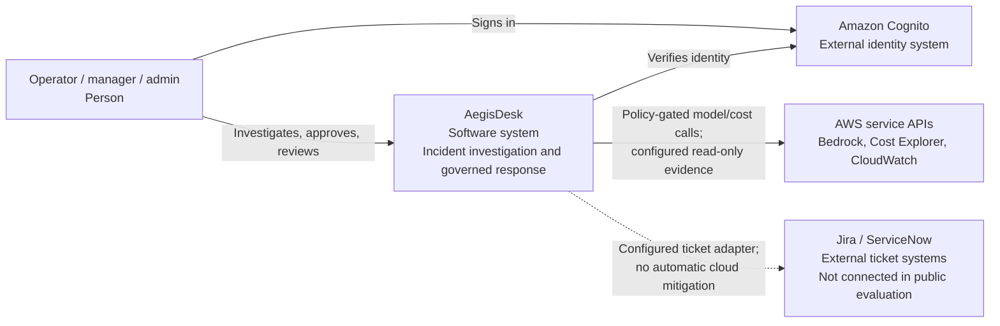
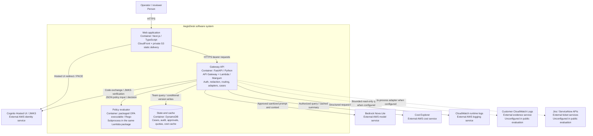

# Architecture Overview

AegisDesk is a self-hosted CloudOps control plane with a static browser UI and a policy-enforced Python API. Its primary workspace preserves team incident cases, read-only evidence, operator findings, exact-action approvals, and ticket outcomes. Supporting chat provides redaction, source grounding, Bedrock routing, cost review, and governance replay.

The public AWS deployment is an **evaluation environment**. The October 10, 2026 deployment verified readiness, authenticated case listing, and rendering, not hosted case writes or live Jira/CloudWatch workflows. [Deployment evidence](evidence/live-operations.md) and [incident boundaries](operations/incident-workflow.md).

## C4 Context (Level 1)

## C4 Containers (Level 2)

These are logical containers and dependencies, not separate microservices. The web application runs in the browser; CloudFront/private S3 deliver its static assets. FastAPI, packaged runbooks, in-process adapters, and the OPA subprocess share the Lambda deployment.

Solid service edges show implemented hosted paths, not customer usage or a successful call on every request. Dashed edges require integration configuration. Jira incident actions have the exact-action lifecycle; preserved ServiceNow chat calls do not share that lifecycle.

**Separate local tooling:** `services/mcp-tools/server.py` is a Python SDK stdio server returning fixture payloads to agent clients. FastAPI does not call it for hosted operations. It has no production incident identity/approval transport. Datadog, Okta, and IAM Identity Center remain adapter extension points, not deployed integrations.

## Runtime And Data Flow

### Incident Workflow

1. The API verifies bearer identity and derives the actor's role/team from claims. All case reads and writes, including admin access, stay within that team.
2. A case snapshot stores title, description, service/resource, severity, environment, notes, version, and activity timeline in the existing state store.
3. Evidence refresh invokes the configured CloudWatch adapter and redacts messages. Empty, unavailable, and stale results remain distinct. No fixture evidence replaces failed collection.
4. The API generates immutable Jira action arguments and a fingerprint of operation, target, arguments, requester, version, and policy. A different same-team manager/admin must approve; approval expires.
5. Dispatch rechecks policy, approval, fingerprint, configuration, and version, then conditionally saves an execution claim before external I/O.
6. A valid provider response records the ticket. Timeout, malformed success, or interrupted persistence leaves an unresolved outcome; reconciliation reads and matches a Jira issue. Cloud recovery is verified by the operator outside AegisDesk.

Snapshots/timelines are saved together, bounded to 280,000 bytes. They are mutable operational state, not immutable audit archives or a distributed transaction with Jira. Hosted reads are verified; hosted writes and real provider execution are not. [Implementation](../services/api/app/incidents.py), [tests](../services/api/tests/test_incidents.py), [ADR-012](adrs/012-persistent-incident-actions.md).

### Supporting Chat And Governance

The gateway validates input, redacts detected secrets/PII, retrieves packaged runbook/policy excerpts, evaluates OPA, applies quota/routing controls, and optionally calls Bedrock or authorized in-process tools. Sensitive, denied, strict-boundary, or model-disabled paths retain deterministic guidance. Cost Explorer is restricted to manager/admin cost workflows and cached.

Backend decisions produce audit records and sanitized replay packets: policy input/output, route, sources, tool outcomes, and trace ID when available. Manager audit reads are team-scoped; the legacy admin audit view is global. Case timelines remain separate from legacy chat replay/export. Pattern redaction cannot guarantee all sensitive content is removed.

## Authentication Flow

Cognito Hosted UI uses authorization code flow with PKCE. The browser receives a callback code and sends it to the API exchange endpoint; the API exchanges it with Cognito. Protected endpoints verify Cognito ID-token signature, issuer, audience, and expiry through JWKS, then derive role/team from claims.

Hosted evaluation also exposes controlled persona access. Production-style setup must disable persona issuance and frontend evaluation tools, configure real customer identity, and verify the actual deployment settings. This environment does not prove enterprise federation, MFA enforcement, or revocation drills. [Identity implementation](../services/api/app/auth.py), [deployment settings](deployment/self-hosted.md).

## Deployment Shape

| Concern | Hosted AWS | Local |
| --- | --- | --- |
| Web | Next.js static export, private S3, CloudFront origin access control | Next.js development process or Compose |
| API | API Gateway HTTP API, Python 3.12 Lambda zip, Mangum | Uvicorn process or Compose |
| Policy | OPA binary and Rego bundled with Lambda | HTTP OPA in Compose; explicit Python fallback for evaluation |
| Persistence | Existing encrypted DynamoDB table, conditional case versions | SQLite, persistent Compose data volume |
| Identity | Cognito/JWKS plus evaluation personas | Controlled local persona tokens; configurable Cognito |
| Telemetry | Structured CloudWatch logs; seven-day retention | OpenTelemetry OTLP HTTP to Jaeger in Compose |
| AI | Optional Bedrock route and deterministic fallback | Deterministic fallback; optional configured model paths |
| Infrastructure | Terraform and S3-backed state | Compose; optional Helm packaging is not the hosted deployment |

DynamoDB TTL bounds short-term legacy audit/cache records; incident snapshots have no TTL or backup policy added by this increment. No hosted trace collector, managed dashboard, or alert-response evidence is supplied.

## AWS And Trust Boundaries

- Frontend S3 public access is blocked; CloudFront origin access control permits static delivery. API Gateway is public HTTPS. Backend identity/policy checks enforce access; CORS is not authorization.
- The deployment does not provision private VPC subnets or a WAF. Customer-strict mode is an application routing/data policy, not an egress firewall or physical account isolation.
- Runtime IAM scopes the state table, Lambda log group, Cognito user pool, and permitted Bedrock model/profile. Cost Explorer uses a wildcard resource; CloudWatch query scope is configurable and must be reviewed. The deploy role has a broader infrastructure blast radius than the runtime role.
- GitHub uses OIDC to assume the deployment role. The persona seed is generated by Terraform and delivered in Lambda environment configuration; state must be treated as sensitive. Integration secrets remain server-side. Automated Secrets Manager integration is not implemented.
- Customer log groups and external ticket systems are operator-owned dependencies. A case's resource ARN does not automatically narrow log results or select per-team AWS credentials. Hosted Jira/CloudWatch are not configured.

[Terraform](../infra/terraform/main.tf), [security overview](security/security-overview.md), [customer boundary](security/customer-data-boundary.md).

## CI/CD Flow

Pushes to `main` and pull requests run nine CI jobs: documentation presence, API/evals/load smoke, security, OPA, MCP, Terraform, frontend build, Playwright, and three container builds.

AWS deployment is a separate manual workflow: OIDC credentials, Lambda packaging, Terraform init/validate/plan; then `confirm=deploy` and the configured GitHub environment allow apply. The apply job builds its own plan, applies it, publishes the static export, requests CloudFront invalidation, and smoke-tests API health. It does **not** apply the saved preflight plan or automatically gate on the separate CI workflow; the operator must verify CI and review changes before dispatch.

Recovery instructions exist; a hosted rollback drill and saved-plan promotion are not claimed. [CI](../.github/workflows/ci.yml), [deployment workflow](../.github/workflows/deploy-aws.yml), [live evidence](evidence/live-operations.md).

## Key Constraints And Tradeoffs

- Policy and human approval remain outside model output. The model cannot execute arbitrary or destructive cloud operations.
- Local fixtures, deterministic guidance, and operator hypotheses must never be labeled verified operational evidence.
- Uncertain external outcomes require reconciliation, not automatic retries or exactly-once claims.
- Low idle cost trades off cold starts, request-duration limits, and limited long-lived connection support.
- Case size/retention, queue scaling, live integrations, identity hardening, backup recovery, and actionable hosted telemetry remain customer-readiness work.
- Budget thresholds do not cap spending. Correlation IDs do not prove trace export.

## Related Docs

- [Reviewer guide](reviewer-guide.md)
- [ADRs](adrs/README.md) and [tradeoffs](architecture/tradeoffs.md)
- [API contracts](architecture/api-contracts.md) and [audit model](architecture/audit-event-model.md)
- [Incident operations](operations/incident-workflow.md) and [failure runbooks](operations/README.md)
- [Data handling](security/data-handling.md) and [threat model](security/threat-model.md)
- [Self-hosted deployment](deployment/self-hosted.md)
